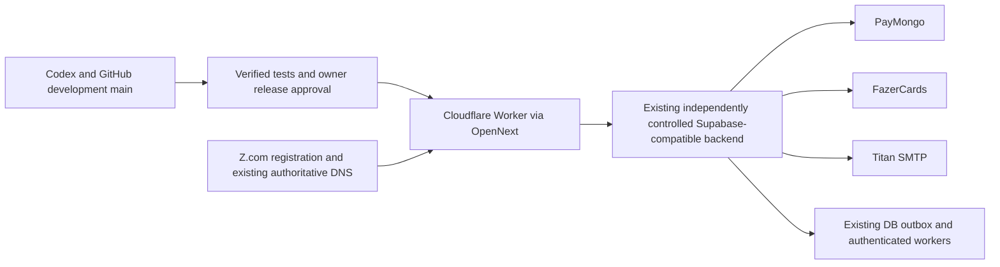

# Infrastructure architecture decision

**Proposed — Requires Owner Approval.** No platform, database, account, subscription or deployment was created. The latest policy excludes Bolt.new/Bolt Cloud from future development/deployment; legacy dependencies are preserved until a safe replacement is verified.

## Primary architecture

Use **Cloudflare Workers with the supported OpenNext adapter for the existing Next application**, retain **Supabase PostgreSQL/Auth/Edge Functions under independently verified owner control**, and reuse **Titan Business Email plus Z.com registration and current authoritative DNS**. The Cloudflare target remains an implementation gate, not a deployment claim: the current tree has no Wrangler/OpenNext configuration and must first pass an isolated Worker-runtime build and request test. Do not add a second database, mail service, queue service or monitoring subscription unless an evidenced gap requires one.

This choice preserves the existing App Router, Postgres/RPC/Auth/Realtime/Deno code, payment/supplier boundaries and SMTP. OpenNext supports Next.js 16, App Router, SSR, route handlers and middleware, but Node.js middleware is not supported; the current [proxy.ts](../../proxy.ts) and every Node-dependent route therefore require runtime testing before adoption. If the existing backend cannot be operated independently, pause selection and follow [database portability](DATABASE_PORTABILITY.md); no migration is authorized by this recommendation.

**Proposed operating responsibilities:** Cloudflare serves the Next.js Worker and HTTPS; Supabase owns data, Auth, Realtime, RPCs and Deno functions; durable fulfillment/reconciliation remains in approved Supabase/Worker background mechanisms rather than a short-lived request. Titan handles approved low-volume application mail and potentially Auth custom SMTP after separate testing. Keep payment verification, webhook validation and supplier fulfillment server-side and idempotent. Private application/provider credentials remain in Supabase Edge Function secrets or other approved Supabase-side secret storage; Cloudflare must not receive service-role, PayMongo, supplier or SMTP private keys.

**Cloudflare compatibility gate:** use `@opennextjs/cloudflare` with Wrangler, `nodejs_compat`, a compatibility date supported by the adapter, only non-secret/public Worker configuration, and a preview build before any deployment. Test cookies/redirects through `proxy.ts`, raw `paymongo-signature` request bodies, Node APIs, dynamic rendering, Supabase calls, subrequest counts, CPU time, cron and failure/retry behavior. Long-running reconciliation and supplier work must use durable queues/workflows/Edge Functions with idempotency; it must not depend on `waitUntil()` alone.

**Current private-secret blocker:** the existing Next.js server surface still references `SUPABASE_SERVICE_ROLE_KEY`, supplier credentials, payment-provider credentials and transactional-mail secrets in [lib/supabaseAdmin.ts](../../lib/supabaseAdmin.ts), [lib/fulfillmentHandoffBatch.ts](../../lib/fulfillmentHandoffBatch.ts), [lib/transactionalEmail.ts](../../lib/transactionalEmail.ts) and related API routes. These files are preserved in Phase 0 because they implement business functionality. Before Cloudflare deployment, the affected privileged operations must be routed through existing Supabase Edge Functions/RPCs or another approved Supabase-side boundary, with equivalent authorization, idempotency and reconciliation tests. `nodejs_compat` is not permission to place those secrets in Worker configuration.

## Legacy configuration and removal plan

- [netlify.toml](../../netlify.toml), `@netlify/plugin-nextjs`, and Netlify-specific scripts/configuration remain unmodified in Phase 0 so unrelated working-tree history is preserved. They are obsolete for the selected production target and should be removed in the authorized Cloudflare implementation phase only after reference checks and a rollback decision.
- Historical Netlify/Vercel/Railway comparisons remain evidence, not alternatives to the owner decision. No fallback deployment is authorized.

[Cost comparison](HOSTING_COST_COMPARISON.md) contains the Cloudflare/Supabase model. Do not configure host-specific DNS targets until the Cloudflare account and deployment identity are verified. Preserve Z.com, Titan and existing DNS records; no DNS or deployment action is authorized in Phase 0.
